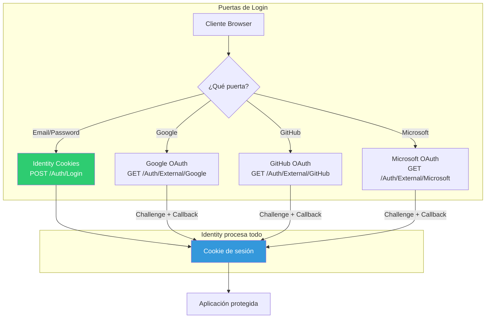

# 17. Authentication Identity

## Índice

[17. Authentication Identity](#17-authentication-identity)
  - [17.1. Configuración](#171-configuración)
  - [17.2. Claims](#172-claims)
  - [17.3. Autorización](#173-autorización)
  - [17.4. Claims Identity](#174-claims-identity)
  - [17.5. Login Externo con OAuth 2.0](#175-login-externo-con-oauth-20)
    - [17.5.1. ¿Qué es OAuth 2.0 y por qué usarlo?](#1751--qués-oauth-20-y-por-qué-usarlo)
    - [17.5.2. Arquitectura: Puertas Múltiples con Identity](#1752-arquitectura-puertas-múltiples-con-identity)
    - [17.5.3. Flujo OAuth](#1753-flujo-oauth)
    - [17.5.4. Implementación en el Proyecto](#1754-implementación-en-el-proyecto)
    - [17.5.5. Configuración](#1755-configuración)
    - [17.5.6. Puntos Clave para el Alumno](#1756-puntos-clave-para-el-alumno)

---

## 17.1. Configuración

### AddIdentityCore

```csharp
builder.Services.AddIdentityCore<User>(options =>
{
    options.Password.RequireDigit = true;
    options.Password.RequireLowercase = true;
    options.Password.RequireUppercase = false;
    options.Password.RequireNonAlphanumeric = false;
    options.Password.RequiredLength = 6;
    
    options.Lockout.DefaultLockoutTimeSpan = TimeSpan.FromMinutes(15);
    options.Lockout.MaxFailedAccessAttempts = 5;
    
    options.User.RequireUniqueEmail = true;
})
.AddEntityFrameworkStores<AppDbContext>()
.AddDefaultTokenProviders();
```

### Configuración de Cookies

```csharp
builder.Services.AddAuthentication(CookieAuthenticationDefaults.AuthenticationScheme)
    .AddCookie(options =>
    {
        options.LoginPath = "/Account/Login";
        options.ExpireTimeSpan = TimeSpan.FromHours(24);
        options.SlidingExpiration = true;
        options.Cookie.HttpOnly = true;
        options.Cookie.SecurePolicy = CookieSecurePolicy.Always;
        options.Cookie.SameSite = SameSiteMode.Lax;
    });
```

---

## 17.2. Claims

### ¿Qué es un Claim?

Un **Claim** es una declaración sobre una entidad, típicamente el usuario.

```csharp
var claims = new List<Claim>
{
    new Claim(ClaimTypes.Name, user.Email),
    new Claim(ClaimTypes.NameIdentifier, user.Id.ToString()),
    new Claim(ClaimTypes.Role, user.Rol),
    new Claim("Department", user.Department),
    new Claim("Level", user.Level.ToString())
};

var identity = new ClaimsIdentity(claims, 
    CookieAuthenticationDefaults.AuthenticationScheme);

var principal = new ClaimsPrincipal(identity);
```

### ClaimTypes Comunes

| Claim Type              | Descripción                              |
| ---------------------- | --------------------------------------- |
| `ClaimTypes.Name`       | Nombre del usuario                      |
| `ClaimTypes.Email`      | Correo electrónico                      |
| `ClaimTypes.NameIdentifier`| Identificador único del usuario       |
| `ClaimTypes.Role`      | Rol del usuario                          |
| `ClaimTypes.GivenName`  | Nombre propio                           |
| `ClaimTypes.Surname`   | Apellido                                |

---

## 17.3. Autorización

### Autorización por Roles

```csharp
[Authorize(Roles = "ADMIN")]
public IActionResult AdminPanel()
{
    return View();
}

[Authorize(Roles = "ADMIN,MANAGER")]
public IActionResult ManagementDashboard()
{
    return View();
}
```

### Autorización por Políticas

```csharp
// Registrar política
builder.Services.AddAuthorization(options =>
{
    options.AddPolicy("RequireModerator", policy => 
        policy.RequireRole("ADMIN", "MODERATOR"));
    
    options.AddPolicy("SeniorUser", policy => 
        policy.RequireClaim("Level", "SENIOR", "LEAD"));
    
    options.AddPolicy("MinimumAge", policy =>
        policy.Requirements.Add(new MinimumAgeRequirement(18)));
});

// Usar política
[Authorize(Policy = "RequireModerator")]
public IActionResult ModeratorPanel()
{
    return View();
}
```

### Claims-based Authorization

```csharp
public class DepartmentHandler : AuthorizationHandler<DepartmentRequirement>
{
    protected override Task HandleRequirementAsync(
        AuthorizationHandlerContext context,
        DepartmentRequirement requirement)
    {
        if (context.User.HasClaim(c => 
            c.Type == "Department" && 
            c.Value == requirement.Department))
        {
            context.Succeed(requirement);
        }
        
        return Task.CompletedTask;
    }
}
```

---

## 17.4. Claims Identity

### ClaimsIdentity vs FormsIdentity

| Aspecto              | FormsIdentity              | ClaimsIdentity              |
| ------------------- | ------------------------ | -------------------------- |
| **Tipo**            | Simple (Name, IsAuth)    | Flexible (colección Claims) |
| **Roles**           | Simple boolean            | Claim                      |
| **Propiedades**     | Limitadas                | Ilimitadas                |
| **Flexibilidad**    | Baja                      | Alta                       |

### ClaimsPrincipal Actual

```csharp
// Obtener usuario actual
var user = User;

// Claims del usuario actual
var userId = User.FindFirstValue(ClaimTypes.NameIdentifier);
var userName = User.Identity?.Name;
var userEmail = User.FindFirstValue(ClaimTypes.Email);
var userRole = User.FindFirstValue(ClaimTypes.Role);

// Verificar roles
if (User.IsInRole("ADMIN"))
{
    // Es admin
}

// Verificar claims
if (User.HasClaim(c => c.Type == "Department" && c.Value == "IT"))
{
    // Es del departamento de IT
}
```

---

## 17.5. Login Externo con OAuth 2.0

### 17.5.1. ¿Qué es OAuth 2.0 y por qué usarlo?

OAuth 2.0 es un **estándar de autorización** que permite a un usuario autenticarse con un proveedor externo (Google, GitHub, Microsoft) sin crear una contraseña nueva en nuestra aplicación.

**¿Qué aporta?**

| Beneficio | Explicación |
|-----------|-------------|
| **UX mejorada** | El usuario no necesita crear ni recordar otra contraseña |
| **Registro automático** | Primer login crea la cuenta local sin formulario |
| **Seguridad delegada** | Google/Microsoft gestionan 2FA y detección de phishing |
| **Educación** | Estándar real usado en producción |

### 17.5.2. Arquitectura: Puertas Múltiples con Identity

A diferencia de las APIs (que usan JWT manual), **ASP.NET Core Identity ya trae soporte OAuth integrado**:



**¿Qué aporta Identity?** (a diferencia de las APIs)

| APIs (custom) | Web (Identity) |
|--------------|----------------|
| ❌ Tabla UserLogin manual | ✅ `AspNetUserLogins` automática |
| ❌ Parsear claims manualmente | ✅ `SignInManager.GetExternalLoginInfoAsync()` |
| ❌ `LoginExternalAsync` custom | ✅ `ExternalLoginSignInAsync()` |
| ❌ Dummy hash para PasswordHash | ✅ Identity maneja usuarios sin password |

### 17.5.3. Flujo OAuth

```mermaid
sequenceDiagram
    participant B as Browser
    participant Web as Web MVC/RazorPages
    participant G as Google OAuth

    B->>GET /Auth/External/Google
    Web->>B: 302 Redirect a accounts.google.com
    B->>G: Login en Google
    G->>B: 302 Redirect a /Auth/ExternalCallback?code=xxx
    B->>GET /Auth/ExternalCallback?code=xxx
    Web->>G: Intercambiar code por tokens
    G-->>Web: Email, Nombre, Avatar
    Web->>Web: GetExternalLoginInfoAsync()
    Web->>Web: ¿Existe vinculación? → SignInAsync()
    Web->>Web: ¿Primera vez? → Crear usuario + AddLoginAsync()
    Web-->>B: 302 Redirect + Cookie de sesión
```

### 17.5.4. Implementación en el Proyecto

**Configuración condicional (`OAuthConfig.cs`):**
```csharp
if (configuration.GetValue<bool>("Auth:Google:Enabled"))
{
    var clientId = configuration["Google:ClientId"];
    var clientSecret = configuration["Google:ClientSecret"];
    if (string.IsNullOrEmpty(clientId) || string.IsNullOrEmpty(clientSecret))
        Log.Warning("🚪 Auth:Google:Enabled=true pero falta credenciales — puerta NO registrada");
    else
        auth.AddGoogle(options => { ... });
}
```

**Endpoints:**

| Proyecto | Challenge | Callback |
|----------|-----------|----------|
| MVC | `GET /Auth/External/{provider}` | `GET /Auth/ExternalCallback` |
| RazorPages | `GET /Auth/External?provider=X` | `GET /Auth/ExternalCallback` |

**Vistas con botones OAuth:**
- `Views/Auth/Login.cshtml` / `Pages/Auth/Login.cshtml`
- `Views/Auth/Register.cshtml` / `Pages/Auth/Register.cshtml`

Los botones aparecen después del `<hr>` y antes del link de cambio de vista.

### 17.5.5. Configuración

**appsettings.json** (Enabled: false por defecto):
```json
{ "Auth": { "Google": { "Enabled": false }, "GitHub": { "Enabled": false }, "Microsoft": { "Enabled": false } } }
```

**user-secrets:**
```bash
dotnet user-secrets set "Google:ClientId" "xxxx.apps.googleusercontent.com"
dotnet user-secrets set "Google:ClientSecret" "GOCSPX-xxxx"
```

### 17.5.6. Puntos Clave para el Alumno

| Concepto | Explicación |
|----------|-------------|
| **No rompe Identity** | OAuth añade esquemas, no modifica Cookies |
| **AspNetUserLogins** | Tabla automática de Identity para vinculaciones |
| **Configuración condicional** | Solo se registra si `Auth:{Provider}:Enabled = true` + credenciales |
| **Mismo patrón en MVC y RazorPages** | 4 vistas con botones + 2 endpoints por proyecto |
| **Identity hace el trabajo** | No necesitamos parsear claims ni crear tablas manualmente |

---

## Resumen

| Concepto           | Descripción                                              |
| ------------------ | -------------------------------------------------------- |
| **Identity**      | Representa al usuario autenticado                         |
| **Claim**         | Declaración sobre el usuario                             |
| **Principal**     | Contiene la identidad y sus claims                      |
| **Authorization** | Control de acceso basado en roles/claims                 |
| **OAuth 2.0**     | Login externo con Google, GitHub, Microsoft (Identity)    |

---

**Anterior**: [16. Manejo de Excepciones](../16-Exception-Handling.md)  
**Próximo**: [18. Authentication Cookies](../18-Auth-Cookies.md)
