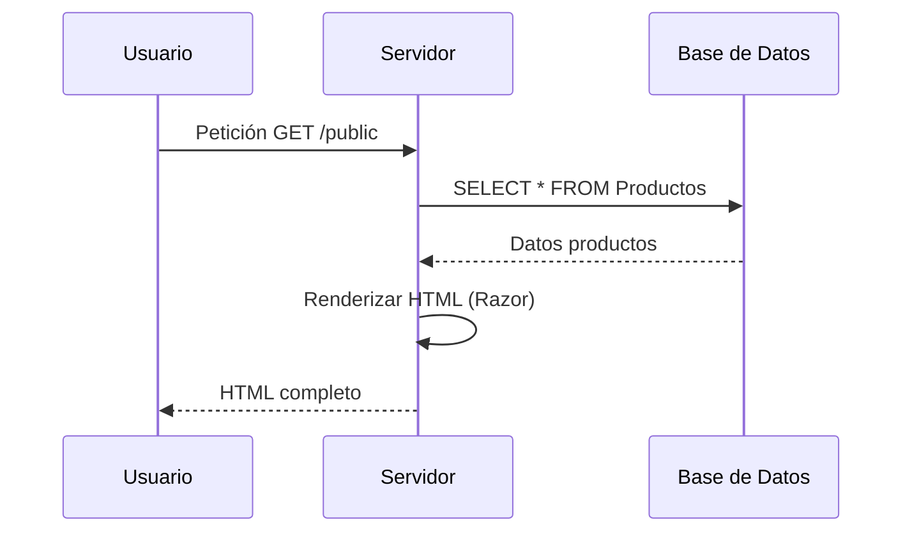
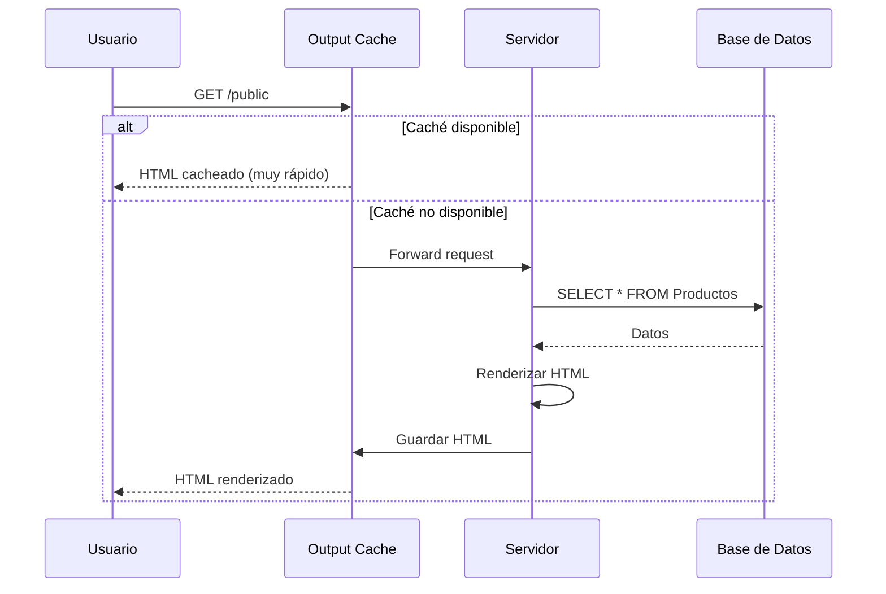
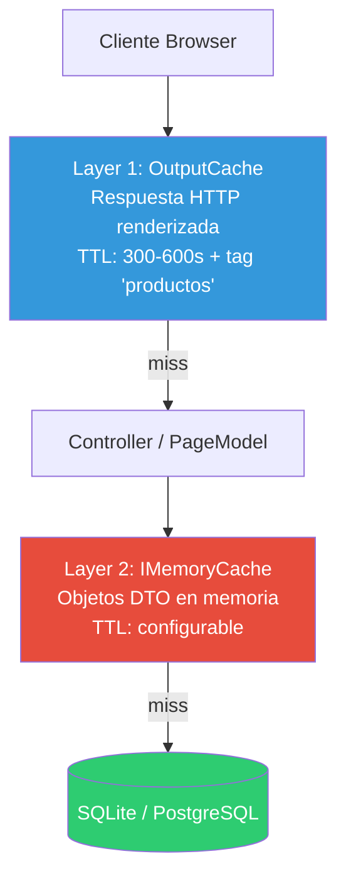

# 23. Optimización de Rendimiento: Output Cache en .NET 10

## Índice

[23. Optimización de Rendimiento: Output Cache en .NET 10](#23-optimización-de-rendimiento-output-cache-en-net-10)
  - [23.1. El Concepto: ¿Por qué cachear el catálogo?](#231-el-concepto-por-qué-cachear-el-catálogo)
  - [23.2. Implementación Técnica](#232-implementación-técnica)
  - [23.3. El desafío de la Variación](#233-el-desafío-de-la-variación)
  - [23.4. Diferencia con ResponseCache](#234-diferencia-con-responsecache)
  - [23.5. Invalidación de Caché](#235-invalidación-de-caché)

---

## 23.1. El Concepto: ¿Por qué cachear el catálogo?

En el escaparate público (`Public/Index`), los productos no cambian cada segundo. Sin embargo, cada vez que un usuario entra o refresca, el servidor:



**Problema**: Cada petición golpea la BD y renderiza HTML.

**Solución**: Output Cache guarda el HTML renderizado.



---

## 23.2. Implementación Técnica

### Registro del Servicio

```csharp
// Program.cs
builder.Services.AddOutputCache();

// Configuración
builder.Services.AddOutputCache(options =>
{
    options.DefaultExpirationTimeSpan = TimeSpan.FromMinutes(5);
    options.SizeLimit = 1000;
});
```

### Aplicación en el Controlador

```csharp
[ApiController]
[Route("api/[controller]")]
public class ProductsController : ControllerBase
{
    [HttpGet]
    [OutputCache(PolicyName = "ProductCache")]
    public async Task<IActionResult> GetProducts(
        [FromQuery] string? category,
        [FromServices] ICacheOutput cacheOutput)
    {
        // Lógica para obtener productos
        var products = await _productService.GetAllAsync(category);
        
        return Ok(products);
    }
}
```

### Con Tag Helpers (Razor Pages)

```html
@page "/products"
@addTagHelper *, Microsoft.AspNetCore.Mvc.TagHelpers

@{
    ViewData["Title"] = "Catálogo de Productos";
}

<cache expires-after="TimeSpan.FromMinutes(10)">
    @await Component.InvokeAsync("ProductList", new { category = "electronics" })
</cache>
```

---

## 23.3. El desafío de la Variación

### VaryByQueryKeys

```csharp
[HttpGet]
[OutputCache(PolicyName = "SearchCache", VaryByQueryKeys = new[] { "search", "page" })]
public async Task<IActionResult> Search([FromQuery] string search, int page = 1)
{
    var results = await _searchService.SearchAsync(search, page);
    return Ok(results);
}
```

### VaryByHeader

```csharp
[HttpGet]
[OutputCache(PolicyName = "ApiCache", VaryByHeader = "Accept-Language")]
public async Task<IActionResult> GetData()
{
    // Cache separado por idioma
    var products = await _productService.GetAllAsync();
    return Ok(products);
}
```

---

## 23.4. Diferencia con ResponseCache

| Aspecto             | ResponseCache                    | Output Cache                  |
| ------------------ | ------------------------------- | ---------------------------- |
| **Qué cachea**    | Headers + HTML                 | HTML completo               |
| **Dónde**          | Cliente + Proxy + Servidor     | Solo servidor               |
| **VaryBy**         | Query, Headers, UserAgent      | Query, Headers, Cookies      |
| **Invalidación**   | Manual                          | Tags + Expiración           |
| **Rendimiento**   | Bueno                           | Mejor (HTML completo)       |

### Cuándo usar cada uno

| ✅ ResponseCache      | ✅ Output Cache                      |
| -------------------- | ----------------------------------- |
| APIs JSON pequeñas   | Páginas Razor completas             |
| Debugging            | Catálogos públicos                  |
| APIs muy variables  | Contenido que no cambia frecuente   |

---

## 23.5. Invalidación de Caché

### Por Tags

```csharp
[HttpPost]
[OutputCacheInvalidate(Tags = new[] { "products" })]
public async Task<IActionResult> CreateProduct([FromBody] CreateProductDto dto)
{
    var product = await _productService.CreateAsync(dto);
    return CreatedAtAction(nameof(GetProduct), new { id = product.Id }, product);
}

[HttpPut("{id}")]
[OutputCacheInvalidate(Tags = new[] { "products" })]
public async Task<IActionResult> UpdateProduct(long id, [FromBody] UpdateProductDto dto)
{
    await _productService.UpdateAsync(id, dto);
    return NoContent();
}

[HttpDelete("{id}")]
[OutputCacheInvalidate(Tags = new[] { "products" })]
public async Task<IActionResult> DeleteProduct(long id)
{
    await _productService.DeleteAsync(id);
    return NoContent();
}
```

### Invalidación con IOutputCacheStore (patrón del proyecto)

El proyecto usa `IOutputCacheStore` para invalidar por tag después de cada operación de escritura:

```csharp
public class ProductController(
    IProductService productService,
    IOutputCacheStore outputCacheStore,
    ...
) : Controller
{
    [HttpPost]
    public async Task<IActionResult> Create(...)
    {
        var result = await productService.CreateAsync(product);
        if (result.IsSuccess)
        {
            // Invalidar OutputCache por tag después de crear
            await outputCacheStore.EvictByTagAsync("productos", CancellationToken.None);
        }
        ...
    }
}
```

> 🎓 **Patrón:** el tag se asigna en `[OutputCache(Tags = new[] { "productos" })]` al leer, y se invalida con `EvictByTagAsync("productos")` después de cada escritura. Así, al crear/editar/borrar un producto, todas las respuestas cacheadas con ese tag se limpian inmediatamente.

> ⚠️ **MVC vs RazorPages:** ambos proyectos deben configurar `Tags` en el OutputCache **y** llamar `EvictByTagAsync` en las operaciones de escritura. Si solo lo tiene uno, el otro mostrará datos stale hasta que expire la caché (5 min por defecto).

**RazorPages — OutputCache con Tags:**
```razor
@* En la vista .cshtml *@
@attribute [OutputCache(Duration = 300, Tags = new[] { "productos" }, 
    VaryByQueryKeys = new[] { "q", "categoria", "page", "size" })]
```

**RazorPages — Invalidación en PageModel:**
```csharp
public class CreateModel(
    IProductService productService,
    IOutputCacheStore outputCacheStore  // ← inyectar
) : PageModel
{
    public async Task<IActionResult> OnPostAsync()
    {
        var result = await productService.CreateAsync(product);
        if (result.IsSuccess)
        {
            await outputCacheStore.EvictByTagAsync("productos", CancellationToken.None);
        }
        ...
    }
}
```

### Mapa Completo de Invalidación OutputCache

El proyecto tiene **dos capas de caché** que se complementan:

```mermaid
flowchart LR
    Client[Cliente] --> OC[OutputCache<br/>300-600s + tag]
    OC -->|miss| SVC[Service]
    SVC --> MC[IMemoryCache<br/>all_products, product_details_{id}]
    MC -->|miss| DB[(SQLite/PostgreSQL)]
    
    style OC fill:#3498db,color:#fff
    style MC fill:#e74c3c,color:#fff
```

| Capa | Qué cachea | Invalidación | TTL |
|------|-----------|--------------|-----|
| **OutputCache** | Respuesta HTTP completa | `EvictByTagAsync("productos")` | 300-600s |
| **IMemoryCache** | Objetos DTO | `cache.Remove("all_products")` manual | Configurable |

### ¿Quién invalida OutputCache?

| Servicio | Operación | ¿Invalida OutputCache? |
|----------|-----------|----------------------|
| `ProductService` | Create/Update/Delete | ✅ Via ProductController / Product CRUD pages |
| `RatingService` | Add/Update/Delete rating | ✅ `InvalidarOutputCacheAsync()` |
| `PurchaseService` | Compra | ✅ `EvictByTagAsync` tras commit |
| `CarritoService` | Add/Remove/Clear | ❌ No — el carrito es datos de usuario, no público |

> 🎓 **Nota:** `RatingService` y `PurchaseService` invalidan OutputCache porque cambian datos visibles públicamente (rating promedio en Details, disponibilidad del producto). `CarritoService` no lo necesita porque el carrito es privado del usuario.

### Invalidación Manual

```csharp
public class CacheService
{
    private readonly ICacheInvalidator _invalidator;

    public async Task InvalidateProductsCacheAsync()
    {
        await _invalidator.CreateRelatedTagInvalidatorAsync("products");
    }
}
```

---

### 🎓 Guía de Supervivencia: Cache Multinivel en Web MVC/RazorPages

#### ¿Qué es la cache multinivel en una app web?

Una app web MVC/RazorPages necesita cachear **dos cosas diferentes**: las respuestas HTTP completas (HTML) y los objetos de negocio (DTOs). Cada una tiene su propia capa de caché.



#### ¿Por qué dos capas en una web?

| Capa | Qué cachea | ¿Por qué? |
|------|-----------|-----------|
| **OutputCache** | HTML completo de la vista | Evita re-renderizar Razor + ejecutar Tag Helpers |
| **IMemoryCache** | Objetos DTO/Entity | Evita ir a la DB cuando varios controllers necesitan los mismos datos |

#### Flujo completo: Petición GET

```mermaid
sequenceDiagram
    participant B as Browser
    participant OC as OutputCache
    participant C as Controller
    participant MC as IMemoryCache
    participant DB as Database

    B->>GET /Public?page=1
    OC->>OC: ¿HTML cacheado con tag 'productos'?
    alt Cache Hit
        OC-->>B: 200 OK (HTML, 0ms)
    else Cache Miss
        OC->>C: Ejecutar action
        C->>MC: GetAllAsync()
        alt Cache Hit
            MC-->>C: Lista de productos
        else Cache Miss
            C->>DB: SELECT * FROM products
            DB-->>C: Datos
            C->>MC: Cachear en memoria
        end
        C-->>OC: Renderizar vista
        OC-->>B: 200 OK (HTML)
    end
```

#### Flujo completo: Escritura

```mermaid
sequenceDiagram
    participant U as Usuario
    participant C as Controller
    participant S as Service
    participant MC as IMemoryCache
    participant OC as OutputCache

    U->>POST /Product/Create
    C->>S: CreateAsync(dto)
    S->>S: Guardar en DB
    S->>MC: Remove("all_products")
    S->>MC: Remove("product_details_{id}")
    C->>OC: EvictByTagAsync("productos")
    C-->>U: Redirect (302)
```

#### Ventajas

| Ventaja | Descripción |
|---------|-------------|
| **Hit rate acumulado** | OutputCache absorbe el 70%, IMemoryCache el 80% del resto → 94% total |
| **Invalidación en dos niveles** | Al escribir, se limpia IMemoryCache (datos) Y OutputCache (respuesta) |
| **Aislamiento** | Si IMemoryCache falla, OutputCache sigue sirviendo respuestas |
| **TTL por capa** | OutputCache 300-600s, IMemoryCache configurable — puedes ajustar cada una |

#### ⚠️ Problemas y Cómo Sobrevivir

| Problema | Síntoma | Solución |
|----------|---------|----------|
| **Datos stale entre capas** | IMemoryCache tiene datos viejos pero OutputCache ya se invalidó | Invalidar **ambas** capas en cada escritura |
| **OutputCache sin tag** | Nadie puede invalidarlo → stale hasta TTL | **Siempre** usar `Tags = ["productos"]` |
| **Servicio no invalida OutputCache** | Rating/Purchase no invalidan → Details muestra datos viejos | Inyectar `IOutputCacheStore` en **todos** los servicios que cambien datos públicos |
| **Carrito invalidando OutputCache** | El carrito es privado — invalidar desperdicia caché | Solo invalidar OutputCache para datos **públicos** |
| **MVC vs RazorPages desincronizados** | Uno tiene tag, el otro no | Mantener ambos proyectos con la misma config |

#### Reglas de Oro del Proyecto Web

```
1. Todo OutputCache DEBE tener Tags:
   [OutputCache(Duration = 300, Tags = new[] { "productos" })]

2. Toda escritura invalida AMBAS capas:
   - IMemoryCache: cache.Remove("all_products")
   - OutputCache: EvictByTagAsync("productos")

3. Solo datos públicos invalidan OutputCache:
   - Productos: ✅ sí
   - Ratings: ✅ sí (cambian el rating visible en Details)
   - Compras: ✅ sí (cambian disponibilidad)
   - Carrito: ❌ no (datos privados del usuario)

4. MVC y RazorPages deben ser IDÉNTICOS:
   - Mismos tags, mismos TTLs, misma invalidación
   - Si uno cambia, el otro también

5. Los servicios en Shared son usados por AMBOS proyectos:
   - RatingService invalida OutputCache → funciona en MVC y RazorPages
   - PurchaseService invalida OutputCache → funciona en ambos
```

#### ¿Cuándo NO usar cache multinivel en Web?

| Escenario | Alternativa |
|-----------|-------------|
| Páginas con datos del usuario (perfil, pedidos) | Sin OutputCache, solo IMemoryCache |
| Formularios POST | Nunca cachear POST |
| Páginas de admin en tiempo real | Sin OutputCache (datos siempre frescos) |
| WebSocket/SignalR | Sin cache (streaming) |

### Resumen

| Concepto           | Descripción                                              |
| ------------------ | -------------------------------------------------------- |
| **Output Cache**  | Caché de HTML completo en el servidor                    |
| **VaryBy**        | Variar caché por query, headers, cookies                |
| **Invalidate**    | Invalidar caché por tags                                |
| **ResponseCache** | Caché de headers y respuestas simples                   |

---

**Anterior**: [22. InMemory Cache](../22-InMemoryCache.md)  
**Próximo**: [24. Docker y Producción](../24-Docker.md)
